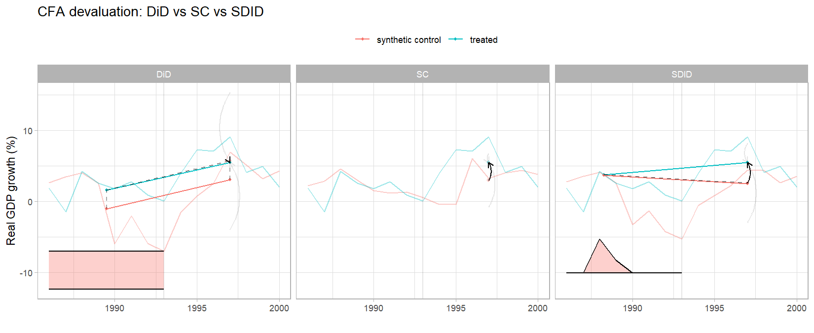
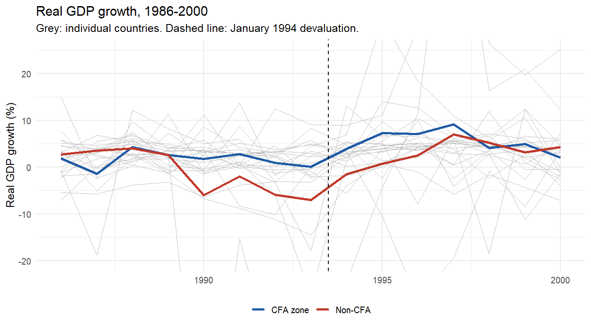

# The 1994 CFA Franc Devaluation: A Synthetic Difference-in-Differences Study

Did the January 1994 devaluation of the CFA franc, which halved its value against the French franc,
raise GDP growth in the 14 CFA-zone countries of West and Central Africa? This project estimates the
effect with three panel-data estimators and explains why they disagree:

- **Difference-in-Differences (DiD)**: relies on parallel trends between CFA and non-CFA countries
- **Synthetic Control (SC)**: builds a weighted counterfactual from non-CFA countries
- **Synthetic Difference-in-Differences (SDID)**, from Arkhangelsky, Athey, Hirshberg, Imbens & Wager
  (2021): reweights both countries and pre-treatment years, then applies DiD

The paper, which covers the method, the case study and a replication of the California
Proposition 99 example, is in
[`docs/SDID_CFA_devaluation_paper.pdf`](docs/SDID_CFA_devaluation_paper.pdf).

## Results

Panel: 14 CFA countries and 9 non-CFA neighbours, real GDP growth 1986–2000, treatment from 1994.

| Estimator | Effect on real GDP growth (pp) | Std. error (jackknife) | 95% CI |
|---|---|---|---|
| DiD | −0.18 | 4.93 | [−9.85, 9.49] |
| SC | +2.52 | 1.91 | [−1.22, 6.25] |
| SDID | **+2.90** | 2.85 | [−2.69, 8.48] |



**Why the estimators disagree.** Before 1994 the two groups did not move in parallel. Several
control countries (Liberia, Sierra Leone, Angola and the DR Congo) were hit by civil wars and
collapsed in 1990–93, so average non-CFA growth fell far below CFA growth just before the
devaluation, then recovered at the same time the devaluation took effect.

- **DiD** compares averages over all pre-1994 years, so it reads that recovery as normal
  non-CFA growth and finds essentially no effect.
- **SC** reweights the control countries to match the CFA growth path and finds about +2.5 pp.
- **SDID** also weights the pre-treatment *years*, putting almost all weight on 1988–89, before
  the conflicts. That gives a cleaner baseline and an estimate of about +2.9 pp.

**Conclusion.** Once the comparison accounts for the conflict-driven collapse among the controls,
the devaluation is associated with roughly 2.5–3 percentage points higher annual GDP growth in the
CFA zone over 1994–2000. That is consistent with the short-run competitiveness gains documented in
the literature. The confidence intervals are wide, though: with 14 treated countries and only 9
controls, none of the estimates is statistically significant at 5%. The weights SDID assigns to
each control country are fairly even (0.08–0.12 each, see `results/sdid_unit_weights.csv`), so no
single country drives the result.



### Proposition 99 replication

The California example reproduces Table 1 of Arkhangelsky et al. (2021) exactly (cigarette packs
per capita, placebo standard errors):

| Estimator | Estimate | Std. error |
|---|---|---|
| DiD | −27.3 | 17.7 |
| SC | −19.6 | 10.9 |
| SDID | −15.6 | 9.9 |

## Repository layout

```
R/01_cfa_devaluation_sdid.R   CFA case study: data, estimates, standard errors, figures
R/02_prop99_replication.R     California Proposition 99 replication
install.R                     Installs required packages
docs/                         The written paper (PDF)
figures/                      Charts produced by the scripts
results/                      Estimates and SDID unit weights (CSV)
```

## Run it

Requires R ≥ 4.1.

```bash
Rscript install.R
```

```bash
Rscript R/01_cfa_devaluation_sdid.R
```

```bash
Rscript R/02_prop99_replication.R
```

Data come from Penn World Table 10.0 via the `pwt10` package (Feenstra, Inklaar & Timmer, 2015);
nothing needs downloading by hand. The outcome is real GDP growth,
100 × Δlog(`rgdpna`), for 1986–2000, with treatment starting in 1994.

## Improvements over the first version

- **Treated/control ordering.** The estimators in `synthdid` assume the first `N0` rows of `Y` are
  controls and the rest are treated. The original code built `Y` with rows in alphabetical order,
  so the "control" block was actually Angola, Benin, Burkina Faso, CAR, Côte d'Ivoire and Cameroon,
  five of which are CFA members. The script now uses `panel.matrices()`, which orders rows
  correctly, and checks that `N0` equals the number of controls.
- **Country matching by ISO code.** Matching on names silently dropped the Republic of Congo
  (PWT calls it "Congo") and the Democratic Republic of the Congo. All 14 CFA members are now
  included.
- **Larger donor pool.** The Gambia and Mauritania were added as controls, since both are non-CFA
  West African economies. Edit `control_iso` to change this.
- **Standard errors and confidence intervals** are reported for every estimator (jackknife;
  placebo SEs need more controls than treated units, which this design does not have).
- **SDID unit weights** are saved so it is clear which countries form the counterfactual.
- **Readable time axes** in the `synthdid` plots, which showed 1970 dates because `Y` had no
  column names.
- The case-study text mentioned export growth while the code uses GDP growth; the code and this
  README use GDP growth throughout.

## References

- Arkhangelsky, D., Athey, S., Hirshberg, D. A., Imbens, G. W., & Wager, S. (2021). Synthetic
  Difference-in-Differences. *American Economic Review*, 111(12), 4088–4118.
- Abadie, A., Diamond, A., & Hainmueller, J. (2010). Synthetic Control Methods for Comparative Case
  Studies. *Journal of the American Statistical Association*, 105(490), 493–505.
- Bertrand, M., Duflo, E., & Mullainathan, S. (2004). How Much Should We Trust
  Differences-in-Differences Estimates? *Quarterly Journal of Economics*, 119(1), 249–275.
- Feenstra, R. C., Inklaar, R., & Timmer, M. P. (2015). The Next Generation of the Penn World Table.
  *American Economic Review*, 105(10), 3150–3182.

## Author

Mahamane Bachir Sadou. Draws on 14 years compiling national accounts at Niger's National Institute
of Statistics (INS Niger).
